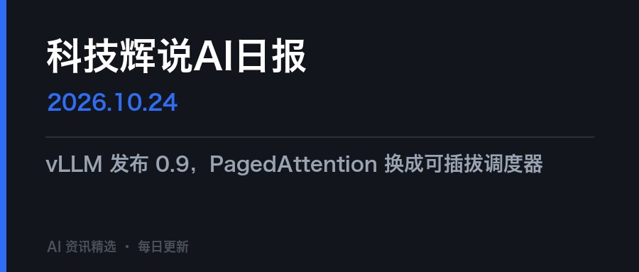

# 科技辉说AI日报

把开源的 [Horizon](https://github.com/Thysrael/Horizon) 变成一份每天早上 7 点自动落进微信公众号草稿箱的科技日报。

抓 20+ 个源 → 按「资讯向」口径打分 → 剔聚合页和广告 → 英文翻中文 → 渲染成微信图文 → 建草稿。
全程无需人工干预，一期约 3 分钟。



---

## 为什么不是「RSS 转 HTML」

现成的 RSS-to-WeChat 工具很多，但直接用会得到一份不能看的东西。这个项目里绝大部分代码
都在处理下面这些「跑起来才会发现」的问题：

| 问题 | 现象 | 处理 |
|---|---|---|
| **聚合页挤掉真新闻** | Techmeme 的「Everything Apple announced」命中率极高，去重时把真正的单条新闻吃掉了 | 聚合页和广告必须在**打分之前**剔除，不是之后 |
| **广告当资讯** | 「Black Friday 立减 40%」被当成科技新闻 | `ad_patterns` 黑名单，中英各一套 |
| **整版被一家媒体占满** | 某天 15 条里 9 条来自同一家 | 每源上限 3 条，候选池先放宽到 2 倍再切 |
| **出处写的是聚合站** | 「Hacker News」——读者想知道是哪家媒体写的 | 聚合站回溯原发媒体，`Hacker News · theverge.com` |
| **微信剥离样式** | `<style>` 和 `class` 全部失效，排版崩掉 | 所有样式内联到 `style` 属性，禁用 `<h1>`–`<h6>` |
| **外链图片被过滤** | 图片全变成灰块 | 先过 `media/uploadimg` 换 `mmbiz.qpic.cn` 域名 |
| **封面中文变方块** | 服务器没装中文字体，图能传但字是豆腐块 | 部署时真的加载一次字体，不是只看文件在不在 |

完整的问题清单和排查方法在 [SKILL.md](SKILL.md)，那是这个项目真正的文档。

## 流水线

```
Horizon 采集 ──► 剔除聚合页/广告 ──► 打分 ──► 去重 ──► 均衡选稿 ──► 每源限 3 条
                                                                        │
                    建草稿 ◄── 上传封面 ◄── 渲染图文 ◄── 翻中文 ◄── 富化(仅 15 条)
```

成本漏斗大致是：抓 190+ 条 → 剩 60 条进打分 → 选出 15 条 → 只对这 15 条做富化和翻译。
富化是耗时大头（每条一次 LLM 调用），所以它放在最后、只对入选条目做。

## 快速开始

**前置条件**

- **已认证**的公众号（订阅号或服务号）。未认证账号没有 `draft/add` 权限
- Python ≥ 3.11、[uv](https://github.com/astral-sh/uv)
- 一个 OpenAI 兼容的 LLM 接口（默认 DeepSeek）

```bash
# 1. 先装 Horizon（内容采集由它负责）
git clone --depth 1 https://github.com/Thysrael/Horizon.git ~/Horizon
cd ~/Horizon && uv sync && cp data/config.example.json data/config.json
# 然后按需编辑 ~/Horizon/data/config.json：信息源开关、AI key

# 2. 装本项目
git clone <this-repo> ~/.workbuddy-ai/skills/horizon-wechat
cd ~/.workbuddy-ai/skills/horizon-wechat
uv venv && uv pip install httpx pillow

# 3. 配凭证
cp .env.example .env && chmod 600 .env   # 填 WX_APPID / WX_SECRET / DEEPSEEK_API_KEY
cp config.example.json config.json       # 品牌名、条数、阈值

# 4. 自检（不要跳过）
python scripts/doctor.py
```

`doctor.py` 会验证 `stable_token`、封面上传、`draft/add` 三项权限。
官方文档对认证订阅号的草稿箱权限表述含糊，**先花两分钟确认，比写完代码才发现没权限划算**。

```bash
python scripts/cli.py run --dry-run   # 只渲染，不碰微信，先在 out/ 看效果
python scripts/cli.py run             # 采集 + 渲染 + 建草稿
python scripts/cli.py preview         # 用已有数据重新排版预览
```

## 配置

`config.json`（从 `config.example.json` 复制）里几个值得改的：

| 字段 | 说明 |
|---|---|
| `wechat.brand` / `digest.title_prefix` | 你的品牌名和标题前缀 |
| `digest.headline_count` / `worth_count` | 头条几条、值得关注几条 |
| `digest.max_per_source` | 单家媒体上限，默认 3 |
| `filter.ad_patterns` / `block_patterns` | 广告和聚合页特征词，中英各一套 |
| `translate.model` / `base_url` | 换成任何 OpenAI 兼容接口 |

## 部署到服务器（可选，但强烈建议）

在家用电脑上跑会遇到一个很烦的问题：**出口 IP 天天变**，而微信的 IP 白名单是精确匹配的。
换一次运营商、甚至路由器重播号，当天就 `40164 IP 不在白名单`，一期日报直接没了。

放到一台有固定 IP 的服务器上，白名单加一次就永久有效，再配 `Persistent=true` 还能补跑。

```bash
HOST=root@1.2.3.4 PORT=22 bash deploy/deploy.sh
```

`deploy.sh` 会把 skill 和 Horizon 仓库推上去，`bootstrap.sh` 在服务器上装依赖、
装中文字体、实测每个源能不能通、配 systemd timer（每天 07:00 北京时间）。

两个容易踩的坑，脚本里已经处理：

- **不传 `.venv`**：本机的 venv 里是 macOS 二进制，搬过去必坏，必须现场建
- **不覆盖运行时状态**：`.env`、`data/state.db`（去重索引）、Horizon 的 `data/config.json`
  （源开关是按机器 IP 实测出来的）都只在远端缺失时才种一份。否则重部署会把服务器
  积累的去重历史和实测结果冲掉

## 目录结构

```
scripts/     cli.py（入口）· bridge.py（调 Horizon）· render.py（微信排版）
             translate.py · cover.py（封面）· wx.py（接口）· state.py（去重）
profiles/    tech-news 的评分 / 分析 / 富化 prompt
deploy/      deploy.sh（本机推）· bootstrap.sh（服务器装）· configure-sources.py（源探活）
docs/        README 配图
SKILL.md     完整文档：约束、踩坑、排错
```

## 已知限制

- **无法查询是否已群发**：`freepublish/batchget` 需要额外权限（报 48001），
  所以只能建草稿，最后一步「群发」得人工点
- **部分源抓不到**：Rest of World 挡机房 IP（403）、VentureBeat 限流（429），
  在美国服务器上依然是关的
- **翻译质量取决于 LLM**：专有名词偶尔会被意译，prompt 里要求保留英文原名但仍不完美
- **单用户设计**：凭证走环境变量，没有多账号/多公众号支持

## 致谢

内容采集全部来自 [Horizon](https://github.com/Thysrael/Horizon)，本项目只负责编辑口径、
翻译、排版和公众号对接。

## License

[MIT](LICENSE)
